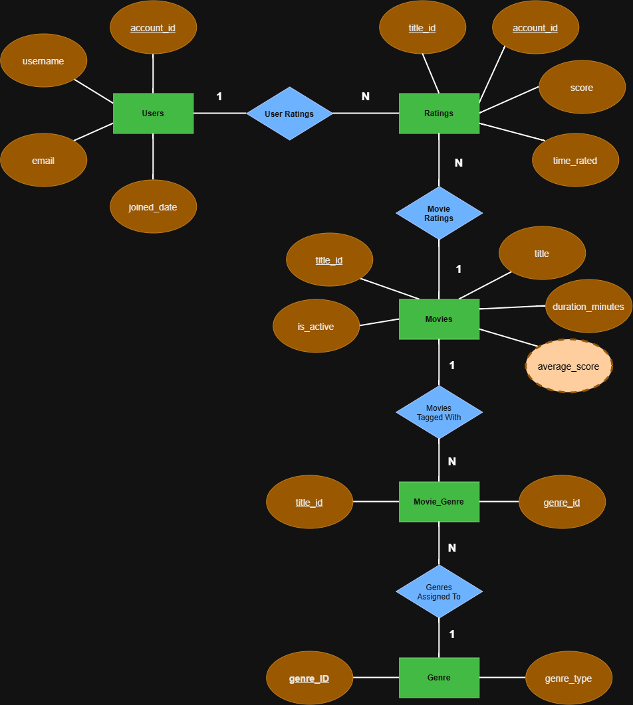

# Movie Ratings Platform: SQL Analysis in PostgreSQL

An end-to-end SQL analysis of a movie-rating platform's data in PostgreSQL, tracing a misleading "50% failure rate" dashboard back to its cause, finding the movies behind the real failures, and measuring whether the platform improved over 2023.

## Contents

- [The domain](#the-domain)
- [Database overview](#database-overview)
- [Query catalogue](#query-catalogue)
- [Technical highlights](#technical-highlights)
- [Findings and recommendations](#findings-and-recommendations)
- [Limitations and future improvements](#limitations-and-future-improvements)
- [Video presentation](#video-presentation)
- [How to run it](#how-to-run-it)
- [Repository structure](#repository-structure)

## The domain

The platform lets registered users rate movies on a 0–5 scale, browse movies by genre, and see an overall score for each title. Every rating passes through moderation: most are **published**, some are **flagged** for review, and some are **withdrawn**, for example as spam, as duplicates, for violating policy, or at the user's own request. A withdrawn rating is the platform's "failure" event. Top reviewers are paid based on their published ratings, so the failure rate directly affects money.

The project started from a real-looking problem. A dashboard reported that about half of all ratings failed, and leadership froze reviewer payouts in response. The questions the platform needed answered were:

- **Is the failure rate on the dashboard correct?** If not, what is the real rate, and why was the dashboard wrong?
- **Where do the failures come from?** Are they spread across the catalog, or concentrated in particular movies?
- **Who and what is behind them?** Which movies attract withdrawn ratings, and which movies get no ratings at all?
- **Is the platform getting better or worse over time,** and what should the team do next quarter?

Each unit of the course added a layer of SQL technique to answer the next question, from basic filtering and NULL handling, through aggregation and joins, to window functions and time-series analysis.

## Database overview

### Design (Units 1–2)

I first designed my own schema for this domain: users, movies, ratings, genres, and a junction table linking movies to genres. The design treats ratings as an associative entity between users and movies, derives each movie's average score at query time instead of storing it, and chooses `ON DELETE` behavior to match how often and how disruptively each kind of deletion happens. The design and its justification are in [`schema/schema-definition.md`](schema/schema-definition.md), [`schema/constraints.md`](schema/constraints.md), [`schema/schema.sql`](schema/schema.sql), [`analysis/unit1.md`](analysis/unit1.md), and [`analysis/unit2.md`](analysis/unit2.md).



### The analysis dataset (Units 3–6)

From Unit 3 onward, all queries run against a **course-provided reference dataset** (DDL and data in [`schema/ex603_movies.sql`](schema/ex603_movies.sql)), so results can be compared across students. It follows the same structure as the design above, with some different table and column names: for example `user_id` instead of `account_id`, `movie_id` instead of `title_id`, and `genres` / `movie_genres` instead of `genre` / `movie_genre`. The data is synthetic: 30 users, 15 movies, 5 genres, and 200 ratings, all from 2023.

The tables the analysis uses:

| Table | Rows | Role | Key columns used |
|---|---|---|---|
| `ratings` | 200 | **Events.** One row per rating, and the main fact table | `rating_id`, `user_id`, `movie_id`, `rated_at`, `score`, `rating_status` (published / flagged / withdrawn), `withdrawn_reason` |
| `movies` | 15 | **Producers.** The catalog of titles being rated | `movie_id`, `title`, `origin_country`, `release_year`, `is_available` |
| `users` | 30 | **Actors.** The accounts submitting ratings | `user_id`, `user_name`, `country` |
| `genres` | 5 | **Catalog.** Genre tags (Drama, Sci-Fi, Comedy, Thriller, Documentary) | `genre_id`, `genre_name` |
| `movie_genres` | 25 | **Junction.** Links movies to genres (many-to-many) | `movie_id`, `genre_id` |

`ratings.user_id` and `ratings.movie_id` are `NOT NULL` foreign keys, so every rating belongs to a real user and a real movie. The dataset also includes a `movie_languages` table, which this analysis does not use.

## Query catalogue

Every `.sql` file starts with a header comment stating the task it answers and the question it resolves in plain language. Screenshots of each query and its results are in [`screenshots/`](screenshots/).

### Unit 3: Filtering, NULLs, and the broken dashboard

| File | Query | Business question |
|---|---|---|
| [q3_1.sql](queries/unit3/q3_1.sql) | 1. Active recent movies | Which available movies were released after 2015? |
| [q3_1.sql](queries/unit3/q3_1.sql) | 2. Distinct statuses | What statuses can a rating have? |
| [q3_1.sql](queries/unit3/q3_1.sql) | 3a / 3b. Range and IN filters | Which ratings fall in a score range, and which are flagged or withdrawn? |
| [q3_1.sql](queries/unit3/q3_1.sql) | 4a–4c. LIKE, NULL, COALESCE | Which titles match a pattern, and which ratings have no withdrawal reason? |
| [q3_1.sql](queries/unit3/q3_1.sql) | 5. Computed columns | How would each published rating be described in plain language? |
| [q3_2.sql](queries/unit3/q3_2.sql) | Part A. NULL trap | How many ratings does a "not spam" filter silently drop, and what is the correct count? |
| [q3_2.sql](queries/unit3/q3_2.sql) | Part B. Alias in WHERE | Which ratings have a weighted score above 5? |
| [q3_3.sql](queries/unit3/q3_3.sql) | Three equivalent forms | Which users have had a rating withdrawn? |

### Unit 4: Aggregation

| File | Query | Business question |
|---|---|---|
| [q4_1.sql](queries/unit4/q4_1.sql) | 1. Whole-table stats | What do ratings look like across the whole platform, and how many users are rating? |
| [q4_1.sql](queries/unit4/q4_1.sql) | 2. Per movie | Which movies get the most ratings, and how do their average scores compare? |
| [q4_1.sql](queries/unit4/q4_1.sql) | 3. HAVING threshold | Among movies with enough ratings to trust (15+), which have the highest withdrawal rates? |
| [q4_1.sql](queries/unit4/q4_1.sql) | 4. Region × status | How do rating outcomes vary by region? |
| [q4_2.sql](queries/unit4/q4_2.sql) | A. Conditional aggregation | For each movie, how many ratings were received and how many were withdrawn? |
| [q4_2.sql](queries/unit4/q4_2.sql) | B. ROLLUP subtotals | What is each region's withdrawal rate, and what is the platform-wide rate? |
| [q4_2.sql](queries/unit4/q4_2.sql) | C. Pipeline | What is a typical withdrawal rate and score for high-volume movies? |

### Unit 5: Joins

| File | Query | Business question |
|---|---|---|
| [q5_1.sql](queries/unit5/q5_1.sql) | Q1. Three-table join | Who rated each movie, which movie was it, and when? |
| [q5_1.sql](queries/unit5/q5_1.sql) | Q2. Junction table | Which movies are tagged Comedy? |
| [q5_1.sql](queries/unit5/q5_1.sql) | Q3. Self-join | Which movies share an origin country with the flagged movies (2, 9, 11)? |
| [q5_2.sql](queries/unit5/q5_2.sql) | Part A. LEFT vs. INNER JOIN | Which movies does an inner join silently drop, and how many? |
| [q5_2.sql](queries/unit5/q5_2.sql) | Part B. RIGHT and FULL OUTER JOIN | Does a RIGHT JOIN match the LEFT JOIN, and are there unmatched rows on either side? |
| [q5_2.sql](queries/unit5/q5_2.sql) | Part C. NOT EXISTS and EXCEPT | Which movies have never been rated? |
| [q5_3.sql](queries/unit5/q5_3.sql) | Part A. CROSS JOIN | What does every movie–genre combination look like, and does the row count equal movies × genres? |
| [q5_3.sql](queries/unit5/q5_3.sql) | Part B. EXPLAIN ANALYZE | How does PostgreSQL execute the three-table join, and which join algorithms does it choose? |

### Unit 6: Window functions and time series

| File | Query | Business question |
|---|---|---|
| [q6_1.sql](queries/unit6/q6_1.sql) | Part 1a. Window AVG | Is each rating unusual compared with its movie's average score? |
| [q6_1.sql](queries/unit6/q6_1.sql) | Part 1b. GROUP BY AVG | What is each movie's average score? (for comparison: 13 rows instead of 200) |
| [q6_1.sql](queries/unit6/q6_1.sql) | Part 2. Three rankings | How do ROW_NUMBER, RANK, and DENSE_RANK order movies by rating count, and how does each handle ties? |
| [q6_1.sql](queries/unit6/q6_1.sql) | Part 3. NTILE(4) | If movies are split into four equal-sized bands, what happens to tied movies at a band boundary? |
| [q6_2.sql](queries/unit6/q6_2.sql) | Part A. LAG / LEAD | For movie 11, is each rating's score higher or lower than the rating before it? |
| [q6_2.sql](queries/unit6/q6_2.sql) | Part B. Running total + moving average | How many ratings has the platform received so far, and how close did 2023 get to its 250-rating target? |
| [q6_2.sql](queries/unit6/q6_2.sql) | Part C. Gap detection | Which movies went more than 90 days without a rating? |
| [q6_3.sql](queries/unit6/q6_3.sql) | Part A. Top 3 per movie | What are the three highest-scored published ratings for each movie? |
| [q6_3.sql](queries/unit6/q6_3.sql) | Part B. Month over month | Is the withdrawal rate getting better or worse each month? |
| [q6_3.sql](queries/unit6/q6_3.sql) | Part B check. Missing months | Are any months missing, which would make LAG compare the wrong months? |

## Technical highlights

**1. Finding and fixing a silent NULL trap (Unit 3).** The dashboard's error came from filtering on `withdrawn_reason`, a column that is NULL for every rating that wasn't withdrawn. A condition like `withdrawn_reason <> 'Spam detected'` evaluates to *unknown* for NULLs, so `WHERE` quietly drops them. My test query lost **166 of 200 ratings** with no error. Repairing it with an explicit `OR withdrawn_reason IS NULL`, and checking the result against the table total, showed the real failure rate was **17%**, not about 50%. ([q3_2.sql](queries/unit3/q3_2.sql))

**2. Conditional aggregation with a trust threshold (Unit 4).** `COUNT(CASE WHEN rating_status = 'withdrawn' THEN 1 END)` computes each movie's total and withdrawn ratings in one pass, and `HAVING COUNT(*) >= 15` excludes movies with too few ratings to trust. Movie 4's 33% rate, for example, came from just 6 ratings. This turned one platform-wide number into a per-movie view that showed where failures concentrate. ([q4_1.sql](queries/unit4/q4_1.sql), [q4_2.sql](queries/unit4/q4_2.sql))

**3. Outer joins and anti-joins to find what's missing (Unit 5).** An INNER JOIN between movies and ratings quietly drops movies that have never been rated, so a report built on it looks complete. A LEFT JOIN with `COUNT(DISTINCT mo.movie_id)` showed 15 movies against the INNER JOIN's 13. `NOT EXISTS` and `EXCEPT` then independently identified the missing two: movies 14 and 15. ([q5_2.sql](queries/unit5/q5_2.sql))

**4. Window functions that keep every row (Unit 6).** `AVG(score) OVER (PARTITION BY movie_id)` puts each movie's average next to every one of its ratings, so unusual ratings stand out without collapsing the data. Running `ROW_NUMBER`, `RANK`, and `DENSE_RANK` side by side showed how much tie handling matters for a public leaderboard. Using `LAG` with `NULLIF` produced month-over-month changes without dividing by zero. ([q6_1.sql](queries/unit6/q6_1.sql), [q6_3.sql](queries/unit6/q6_3.sql))

**5. Reading an execution plan (Unit 5).** `EXPLAIN ANALYZE` on the three-table join showed PostgreSQL using a **hash join** for users, which is small and has no index on `ratings.user_id`, and a **nested loop with an index scan and Memoize** for movies, which is looked up by primary key. It also exposed a stale row estimate (100 rows estimated for users, 30 actual), the kind of gap that can lead the planner to a poor choice on large tables. ([q5_3.sql](queries/unit5/q5_3.sql), [analysis/unit5.md](analysis/unit5.md))

## Findings and recommendations

**1. The real failure rate is 17%, not about 50%, and the payout freeze was based on a wrong number.**
Of 200 ratings, 34 were withdrawn. The dashboard's figure came from a NULL-handling error that dropped most successful ratings from its count. *Recommendation:* revisit the payout freeze using the corrected rate, and check every dashboard against a simple row total before it is used for decisions. ([unit3-finding.md](analysis/unit3-finding.md), [unit4-findings.md](analysis/unit4-findings.md))

**2. Failures are concentrated in a few movies, and two movies get no engagement at all.**
Movies **11, 2, and 9** have withdrawal rates of 25–31%, against a typical 16%, and three of movie 2's four withdrawals were spam. Separately, movies **14 and 15** have never been rated, and neither has a genre tag, so they don't appear when users browse by genre. *Recommendation:* focus moderation on the three high-withdrawal movies, and tag and feature the two never-rated movies before deciding whether to keep them. ([unit4-findings.md](analysis/unit4-findings.md), [unit5-finding.md](analysis/unit5-finding.md))

**3. The failure rate improved early in 2023 and then levelled off, while engagement stayed flat.**
The withdrawal rate fell from **22.6%** in the first quarter to **14.6%** in the second, then stayed close to 15% for the rest of the year. Ratings volume barely changed from quarter to quarter, and the year ended at **200 ratings, 80% of a 250-rating target**. *Recommendation:* treat about 15% as the current baseline and aim below 12% next quarter, report the rate by quarter rather than month, and track a running total against a quarterly ratings target. ([unit6-finding.md](analysis/unit6-finding.md))

## Limitations and future improvements

**The dataset is small, so short-term trends are unreliable.** With 200 ratings across a year, each month has only 11 to 21 ratings, and one or two withdrawals swing the monthly rate by 5 to 10 percentage points. For example, June's rate was more than double May's. I handled this by drawing conclusions from quarterly figures instead of monthly ones, but it still limits how confidently the trend can be read.

**The database records outcomes, not causes.** It shows *that* a rating was withdrawn and *that* a movie went 113 days without a rating, but not *why*. There's no viewing history, moderation log, or account history. With that data, future analysis could separate spam waves from policy changes, tell "users stopped watching" from "users watched but didn't rate", and explain the improvement after the first quarter rather than only measuring it.

## Video presentation

▶️ **[Watch the presentation]((https://1drv.ms/v/c/e01d8fa59718084e/IQCDrqzTpG4aSplCWmTsJ3OPAS0wNvBOu16czGoqwDijLrI?e=I5QMIX))** (3–5 minutes): the platform's main question, two or three representative queries including Unit 6 window functions, key findings, and next-quarter recommendations.

## How to run it

**Requirements:** PostgreSQL 14 or later, with the `psql` command-line client.

**1. Create the database and load the dataset** (schema and data in one file):

```bash
createdb ex603_movies
psql -d ex603_movies -f schema/ex603_movies.sql
```

The script drops and recreates its tables, so it is safe to run again.

**2. Run a query file:**

```bash
psql -d ex603_movies -f queries/unit6/q6_1.sql
```

Or run a single query interactively:

```bash
psql -d ex603_movies -c "SELECT rating_status, COUNT(*) FROM ratings GROUP BY rating_status;"
```

You can also open the database in a GUI client such as DataGrip or pgAdmin, and run each query in the `.sql` files on its own. Connection details depend on your own PostgreSQL setup. None are stored in this repository.

**Optional:** to load my original Units 1–2 design instead (empty tables, no data), run `schema/schema.sql` in a separate database.

## Repository structure

```
.
├── README.md
├── schema/
│   ├── ERD.png                  ER diagram of the original design (Unit 1)
│   ├── schema-definition.md     Relation schemas, attributes, domains, keys (Unit 1)
│   ├── constraints.md           Integrity constraints and ON DELETE choices (Unit 1)
│   ├── schema.sql               DDL for the original design (Unit 2)
│   └── ex603_movies.sql         Course-provided dataset used for all analysis (Units 3–6)
├── queries/
│   ├── unit3/  q3_1–q3_3.sql    Filtering, NULL handling, equivalent forms
│   ├── unit4/  q4_1–q4_2.sql    Aggregation, HAVING, ROLLUP, CTE pipeline
│   ├── unit5/  q5_1–q5_3.sql    Joins, anti-joins, CROSS JOIN, EXPLAIN
│   └── unit6/  q6_1–q6_3.sql    Window functions, rankings, time series
├── analysis/
│   ├── unit1.md, unit2.md       Design justification and reflection
│   ├── unit3-finding.md         The dashboard failure-rate correction
│   ├── unit4.md, unit4-findings.md   Aggregation write-ups; per-movie failure rates
│   ├── unit5.md, unit5-finding.md    Join write-ups; high-withdrawal vs. never-rated movies
│   └── unit6.md, unit6-finding.md    Window-function write-ups; trend and next-quarter memo
└── screenshots/                 Query-and-result captures for each unit
```
